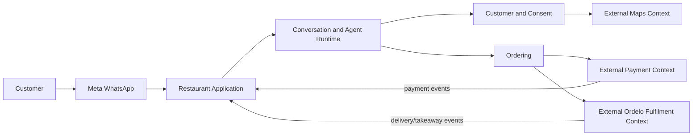

# Restaurant Platform Domain Model

This document maps the entire domain visible to `restaurant-agents`. It covers
internal bounded contexts and the contracts crossing to external systems; it
does not claim ownership of external systems' private models.

## Human-Friendly Code Map

- [Runtime records, Enquiry Menu, and graph protocol](../../packages/restaurant-agent-runtime/src/restaurant_agent_runtime/runtime.py)
- [Application composition](../../packages/restaurant-agent-runtime/src/restaurant_agent_runtime/web/app_factory.py)
- [Operational lookup cache](../../packages/restaurant-agent-runtime/src/restaurant_agent_runtime/services/operational_lookup_cache.py)
- [Customer and consent models](../../packages/restaurant-agent-runtime/src/restaurant_agent_runtime/services/ordelo_service/datamodels/customer_master_pymodel.py)
- [Customer-Restaurant relationship](../../packages/restaurant-agent-runtime/src/restaurant_agent_runtime/services/ordelo_service/datamodels/cust_rest_map_pymodel.py)
- [Restaurant operational master](../../packages/restaurant-agent-runtime/src/restaurant_agent_runtime/services/ordelo_service/datamodels/restaurant_master_pymodel.py)
- [FoodOrder aggregate](../../packages/restaurant-agent-runtime/src/restaurant_agent_runtime/services/order_management/food_order_pymodel.py)
- [Delivery contract payloads](../../packages/restaurant-agent-runtime/src/restaurant_agent_runtime/services/order_management/delivery_pymodels.py)
- [Takeaway contract payloads](../../packages/restaurant-agent-runtime/src/restaurant_agent_runtime/services/order_management/takeaway_pymodels.py)
- [Conversation Thread lifecycle](../../packages/restaurant-agent-runtime/src/restaurant_agent_runtime/services/thread_management/thread_handler.py)
- [Agent runtime state and context](../../packages/restaurant-agent-runtime/src/restaurant_agent_runtime/rest_agent/agents/agent_harness.py)
- [Service-hours model](../../packages/restaurant-agent-runtime/src/restaurant_agent_runtime/services/service_hours/schedule.py)
- [Order webhook boundary](../../packages/restaurant-agent-runtime/src/restaurant_agent_runtime/watomation/routers/order_event_hooks.py)
- [Rider webhook boundary](../../packages/restaurant-agent-runtime/src/restaurant_agent_runtime/watomation/routers/rider_event_hooks.py)

## Platform Boundary

The repository owns independently deployed Restaurant Applications and their
shared runtime. It owns conversation orchestration and local persisted business
records. Meta WhatsApp, Ordelo/rider/takeaway fulfilment, payment services, and
maps/geocoding are external bounded contexts. PostgreSQL/Supabase, AWS Secrets
Manager, and Fly are infrastructure providers rather than business contexts.



## Internal Bounded Contexts

| Context | Owns | Does not own |
| --- | --- | --- |
| Restaurant Application | Deployment identity, presentation, WABA selection, app assembly | Another app's configuration or prompts |
| Restaurant Operations | RestaurantMaster, administrators, address, coordinates, venue hours, operational settings | App routing identity or external fulfilment internals |
| Customer and Consent | CustomerMaster and per-Restaurant CustRestMap consent | Conversation checkpoints or order state |
| Conversation Runtime | Thread lifecycle, AgentState, ContextSchema, graph checkpoints | Authoritative customer, order, payment, or fulfilment facts |
| Agent Orchestration | Standard graph, Named Agents, tools, handoffs, prompts supplied by apps | External-system internals or app-owned incompatible graph behavior |
| Ordering | FoodOrder and OrderItem consistency boundary | Payment transaction truth or dispatch truth |
| Service Availability | Parsed WeeklySchedule, venue open/closed and new-order cutoff decisions | RestaurantMaster persistence |
| Integration Boundary | Validated webhooks, callbacks, routes, projection updates, runtime isolation | Authority over external events |
| Reservations | Reservation models and hooks present in the package | Standard app assembly; reservation router is not currently included by `create_restaurant_app()` |

Direct payment hooks are also present as inactive/TBD code. The active standard
assembly receives payment completion through the order-event boundary.

## Authority and Projection Rules

```text
Order details:
FoodOrder in DB > Thread/AgentState runtime references

Payment state:
External payment system > FoodOrder.payment_status > AgentState runtime cache

Fulfilment state:
External Ordelo/rider/takeaway workflow > FoodOrder fulfilment projection
> AgentState runtime cache
```

`>` means “is authoritative over,” not data-flow direction. A lower-level
projection may be updated from an event but must not contradict its source.

## Core Records by Role

### Persisted business records

| Record | Role |
| --- | --- |
| `RestaurantMaster` | Mutable Restaurant operations source of truth |
| `CustomerMaster` | Cross-Restaurant customer profile |
| `CustRestMap` | Per-Restaurant customer relationship and consent |
| `FoodOrder` | Order aggregate root for delivery and takeaway variants |
| `OrderItem` | Child record within a FoodOrder |

### Runtime and composition records

| Record | Functional interpretation | Role |
| --- | --- | --- |
| `RestaurantIdentity` | Validated immutable value | Routes one app and selects one WABA namespace |
| `RestaurantPresentation` | Immutable configuration value | Supplies app-owned branding and bounded interactive menu copy |
| `RestaurantSettingsBundle` | Environment/dependency record | Groups settings and clients loaded once at app composition |
| `RestaurantRuntime` | Reader-style environment | Carries the exact app identity, settings, WhatsApp clients, and operational lookup cache |
| `OperationalLookupCache` | Process-local runtime capability | Caches only stable operational configuration; never transactional records |
| `RestaurantPrompts` | Immutable input record | Supplies complete app-owned prompts |
| `AgentBindings` | Record of functions/types | Supplies native WhatsApp callback composition values |
| `Thread` | Persisted runtime session | Correlates Restaurant, recipient, graph checkpoint, and lifecycle |
| `AgentState` | Runtime state map | Drives graph routing and conversational continuity |
| `ContextSchema` | Per-run environment | Makes exact runtime capabilities available to tools |

`frozen=True` prevents rebinding dataclass fields; it does not make referenced
database or WhatsApp clients pure or deeply immutable.

### Incoming contract records

| Record | Reported contract |
| --- | --- |
| `DeliverySummary` | Delivery progress reported by external fulfilment |
| `DeliveryDispatch` | Rider assignment/dispatch data |
| `TakeawaySummaryData` | Takeaway preparation and pickup progress |
| `TakeawayPickupTimePayload` | Updated pickup-time event |
| `TakeawayReadyPayload` | Restaurant-ready event |
| `CallbackButtonData` | WhatsApp callback selection |
| `StaleThreadCandidate` | Thread selected by the external scheduled job for termination |

## Commands and Events

Commands express an operation requested of this platform or an external
context. Events report something that has already happened.

| Commands | Events |
| --- | --- |
| Start or continue Restaurant conversation | WhatsApp message received |
| Create/update customer | Marketing consent captured |
| Create FoodOrder | Payment completed/failed/cancelled |
| Generate payment intent | Rider assigned |
| Capture or cancel payment | Food collected from Restaurant |
| Confirm delivery address | Rider entered Restaurant/customer area |
| Update takeaway pickup time | Delivery timed out/completed |
| Terminate stale Thread | Takeaway pickup time updated/order ready |

## Invariants

- A Restaurant Application serves exactly its configured `rest_ref` and WABA
  namespace.
- Cross-Restaurant routes return `404` before graph invocation or side effects.
- One async WhatsApp client is constructed per app runtime and passed through
  handlers, services, graph context, and tools.
- Apps do not import one another; the shared runtime does not import an app.
- FoodOrder is authoritative over order details; runtime state is not.
- External payment and fulfilment contexts are authoritative over their state.
- Marketing consent is scoped to Customer plus Restaurant.
- RestaurantMaster venue hours govern enquiries; new delivery/takeaway flow entry and menu sends close 15 minutes before each service interval ends.
- Complaint administration is owned by Ordelo: restaurant apps submit validated complaints but do not read or message administrators directly.
- Complete prompts are app-owned.
- Settings are loaded once at explicit application composition; configuration
  model imports do not fetch secrets or publish process-global clients.
- Operational configuration may be cached only through the exact runtime's
  Operational Lookup Cache; its database source remains authoritative, and
  failed, missing, stale, or transactional data is never cached.
- New graph/state semantics use an app-owned GraphAdapter rather than mutation
  of private shared-runtime internals.
- The standard WhatsApp surface exposes the side-effecting `/paid3100` payment
  simulator for the sender's latest eligible order. `/test` and `/test-t` are
  absent; `/reset` changes only Thread lifecycle and `/debug` is read-only and
  authorized-user gated.

## Code References (Machine-Readable)

```code-ref
file: packages/restaurant-agent-runtime/src/restaurant_agent_runtime/runtime.py
symbol: RestaurantRuntime
feature: platform-domain-model
description: >
  Immutable environment record carrying one application's identity, presentation, settings, exact WhatsApp clients, and operational lookup cache.
```

```code-ref
file: packages/restaurant-agent-runtime/src/restaurant_agent_runtime/services/operational_lookup_cache.py
symbol: OperationalLookupCache
feature: platform-domain-model
description: >
  Runtime-owned TTL cache for non-transactional operational configuration and the database-backed Overwatch allowlist.
```

```code-ref
file: packages/restaurant-agent-runtime/src/restaurant_agent_runtime/services/order_management/food_order_pymodel.py
symbol: FoodOrder
feature: platform-domain-model
description: >
  Persisted order aggregate used for both delivery and takeaway fulfilment variants.
```

```code-ref
file: packages/restaurant-agent-runtime/src/restaurant_agent_runtime/services/ordelo_service/datamodels/customer_master_pymodel.py
symbol: CustomerMaster
feature: platform-domain-model
description: >
  Persisted cross-Restaurant customer profile keyed by the customer's WhatsApp identifier.
```

```code-ref
file: packages/restaurant-agent-runtime/src/restaurant_agent_runtime/services/ordelo_service/datamodels/cust_rest_map_pymodel.py
symbol: CustRestMap
feature: platform-domain-model
description: >
  Persists the per-Restaurant customer relationship and marketing-consent state.
```

```code-ref
file: packages/restaurant-agent-runtime/src/restaurant_agent_runtime/rest_agent/agents/agent_harness.py
symbol: AgentState
feature: platform-domain-model
description: >
  Runtime LangGraph state for conversation continuity and routing, not authoritative business state.
```

## Known Modeling Gaps

- Direct WhatsApp catalog-order creation is not part of the current standard
  application flow. A future consumer requires a separately designed command
  with injected persistence; ADR-0009 records the current no-writer decision.
- FoodOrder fulfilment and payment fields are stringly typed; this document
  records authority but does not invent enums absent from the implemented
  contract.
- Reservation code exists but is not part of standard app assembly.
- Direct Stripe webhook code is inactive/TBD; active payment completion arrives
  through order-event hooks.
