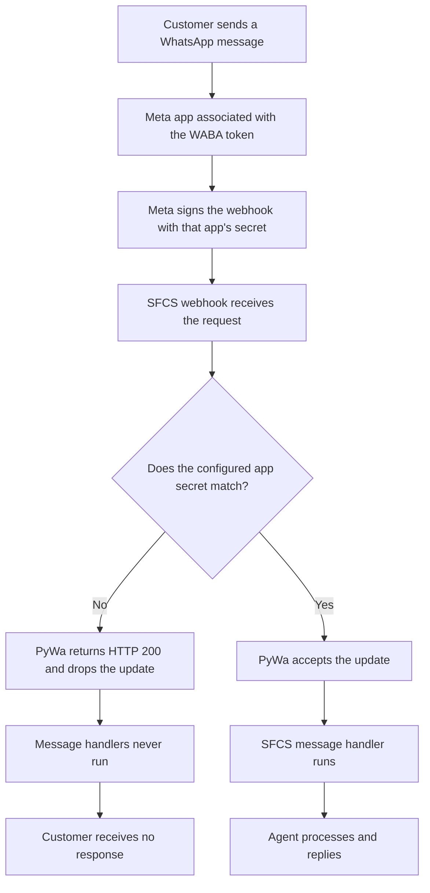
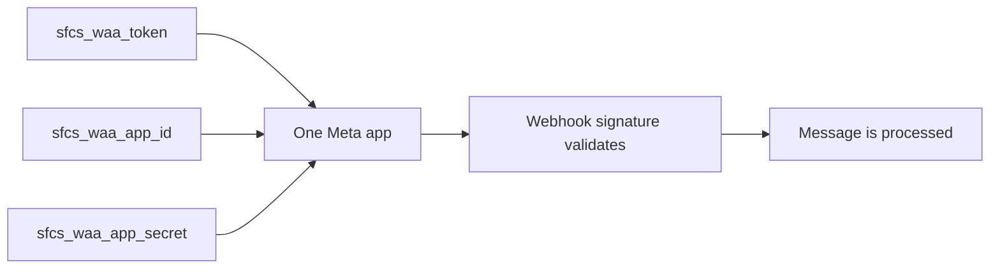

# Incorrect WABA Config (No Response) Issue

> **Update 2026-08-17 (ADR-0022):** `validate_updates` is now `False` for
> every app, superseding this document's "the monorepo intentionally keeps
> validation enabled" conclusion below. **The specific symptom this document
> describes — messages silently dropped due to mismatched `app_id`/
> `app_secret` — can no longer happen**, because the signature check that
> caused the drop is off. That does not mean the underlying credential
> mismatch is fixed or safe to ignore: `app_id` is still required
> independently for `override_waba_callback_url` and media-template
> creation, and a wrong `app_secret` is a security-relevant fact about the
> namespace even when it no longer blocks message delivery. Use this
> document's diagnostic steps to find a credential mismatch; do not use its
> "re-enable validation" framing as the fix — read ADR-0022 first.

## Summary

A WhatsApp callback can register successfully while incoming messages are never
processed. In this failure, Meta reaches the webhook and receives HTTP `200`, but
PyWa drops the message before any application handler runs.

The cause is a mismatched set of Meta credentials:

- the WABA token belongs to one Meta app;
- the configured app ID and app secret belong to another Meta app.

These three settings must belong to the **same Meta app**:

```text
<namespace>_waa_token
<namespace>_waa_app_id
<namespace>_waa_app_secret
```

For example, an SFCS process loads only the `sfcs_` versions of all three
settings.

## What the failure looks like



The important detail is that HTTP `200` does **not** prove the message was
processed. PyWa deliberately returns `200` for an invalid signature so Meta does
not repeatedly deliver an update that the application cannot trust.

## Confirmed SFCS example

The issue was confirmed on 29 July 2026 with this configuration:

| Configuration role | Meta app |
|---|---|
| App ID loaded by the SFCS runtime | `1015019633204520` |
| App that issued the SFCS WABA token | `604290168832304` (`byteLoopAi`) |
| App under which Meta registered the callback | `604290168832304` (`byteLoopAi`) |

The WABA, phone number, callback URL, and tunnel routing were correct. The app
credential mismatch was the remaining reason messages were acknowledged but not
handled.

## Why callback registration still succeeds

Callback registration and message signature validation prove different things:

1. The callback challenge proves that the URL is reachable and that both sides
   use the same verify token.
2. The WABA callback update uses the WABA token. Meta therefore registers the
   callback under the app that issued that token.
3. Incoming message validation uses the configured app secret. If that secret
   belongs to another app, the signature check fails.

Therefore, a successful challenge or callback update does not prove that the
runtime has the correct app secret.

## Correct configuration

Choose one Meta app and make the complete namespace consistent:



For the confirmed SFCS case, the direct correction is:

```text
sfcs_waa_app_id = 604290168832304
sfcs_waa_app_secret = <the secret for the byteLoopAi app>
```

Keep the current SFCS token only if `byteLoopAi` is the intended SFCS Meta app.
If app `1015019633204520` is instead the intended app, issue a new WABA token
from that app and register its callback again.

Never copy an app secret from another namespace merely because callback
registration succeeds.

## Recovery steps

1. Identify the Meta app that issued the namespaced WABA token.
2. Set the namespace's app ID and app secret to credentials for that same app,
   or replace the token with one issued by the intended configured app.
3. Update the approved secret store without printing or committing credentials.
4. Completely stop and restart the restaurant process. The AWS-backed settings
   are loaded during import, so an already running process retains the old
   values.
5. Confirm `/details` reports the expected namespace, WABA ID, phone ID, app ID,
   masked credential hints, display number, effective and configured
   callbacks, admins, and service hours. `validate_updates` reports `false`
   for every app since ADR-0022 — that is expected, not a signal to chase.
   Check `details_errors` before trusting unavailable enrichment fields.
6. Run the callback preflight checks before executing any callback update.
7. Send one approved test message and verify that a message handler runs and a
   fresh reply is produced.

## Common misleading signals

| Signal | What it actually proves |
|---|---|
| Callback challenge returns `200` | The URL and verify token work |
| Callback update succeeds | The WABA token can register its app |
| Phone/WABA lookup succeeds | The token can access that phone and WABA |
| Message webhook returns `200` | Meta's request was acknowledged, not necessarily processed |
| Messages process correctly | Signature validation is off repo-wide (ADR-0022) and no longer proves the credentials match |

The older standalone SFCS application used `validate_updates=False`, which is
why mismatched app credentials went unnoticed there. As of ADR-0022, this
monorepo uses the same setting for the same reason (local/ngrok testing
friction) — the failure mode this document describes cannot reproduce here
anymore, but that also means "messages are working" is no longer evidence
the credentials are correct. Use the diagnostic steps above on their own
merits, not as a proxy for "the app secret matches."

## Relevant code

- [`WabaBusinessSettings.for_namespace`](../packages/restaurant-agent-runtime/src/restaurant_agent_runtime/config/waba_setting.py)
  loads one exact WABA namespace without fallback.
- [`WabaBusinessSettings.create_async_client`](../packages/restaurant-agent-runtime/src/restaurant_agent_runtime/config/waba_setting.py)
  passes the selected token and app secret to PyWa with
  `validate_updates=WABA_VALIDATE_UPDATES` (`False` since ADR-0022).
- [`waba_callback.py`](../packages/restaurant-agent-runtime/src/restaurant_agent_runtime/waba_callback.py)
  contains the fail-before-write token/app, WABA/phone, runtime identity, and
  post-update callback checks.
